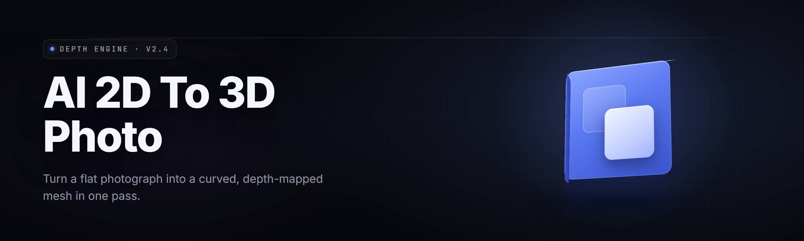

  
  
  

  

  
  
  

---

**photo-to-3d-converter** — an AI 2D-to-3D photo converter for Windows that turns single flat photos into textured, downloadable 3D meshes. Drop a JPG in, pull a `.obj` / `.glb` out. No pip, no npm, no git clone — extract and run the `.exe`.

---

## 📋 System Requirements

Requirements block first, because nothing else matters if your rig can't run it.

| Component | Minimum | Recommended |
|-----------|---------|-------------|
| OS | Windows 10 64-bit (build 1903+) | Windows 11 23H2+ |
| CPU | 4-core x64, AVX2 | 8-core x64 (Ryzen 5 5600X / i5-12400 or better) |
| GPU | Integrated (Intel UHD 630 / Vega 8) | NVIDIA RTX 3060 12GB / AMD RX 6700 XT |
| VRAM | 2 GB shared | 8 GB dedicated |
| RAM | 8 GB | 16 GB |
| Disk | 3.5 GB free | 12 GB free (SSD) |
| Runtime | DirectX 12, VC++ 2019+ redist | CUDA 12.x or ROCm 5.7 (optional, GPU accel) |
| Display | 1280×720 | 1920×1080+ |

> If you're on a laptop with switchable graphics, force the `.exe` onto the discrete GPU in Windows Graphics Settings — the integrated chip will crawl on the Depth-Anything backbone.

---

## 🎯 Usage Guidelines

| Allowed | Not allowed |
|---------|-------------|
| Convert your own photos, scans, artwork | Converting photos of people without their consent |
| Commercial use of generated meshes | Reselling the raw `.exe` as your own product |
| Modding textures, slapping your own UVs on top | Bundling the runtime into a paid SaaS without attribution |
| Batch-converting entire folders overnight | Scanning copyrighted 3D-scanned museum assets and redistributing |
| Training a LoRA on top of your own exports | Stripping the watermark module and reuploading builds |

---

## 🧊 Overview

| Category | Details |
|----------|---------|
| What it is | Standalone AI 2D-to-3D photo converter — single-photo depth + diffusion-completion pipeline |
| Input formats | JPG, PNG, WEBP, BMP, TIFF, HEIC |
| Output formats | OBJ, GLB, GLTF, PLY, STL, FBX (beta) |
| Peak mesh density | Up to 4.2M faces per photo (configurable) |
| Depth backbones | Depth-Anything-V2, MiDaS-DPT, ZoeDepth (switchable) |
| Texture resolution | 512 / 1024 / 2048 / 4096 px |
| Batch throughput | ~40 single photos in 18 min on RTX 3060, 1024px |
| Model cache | On-disk, ~2.1 GB unpacked on first launch |
| GPU accel | CUDA 12.x, ROCm 5.7, DirectML fallback |

This is a converter that does one thing and does it well: it reads a photo, hallucinates the geometry behind it, and hands you a mesh you can drop into Blender, Unity, Unreal, or a 3D printer slicer. Every intermediate — depth map, point cloud, alpha mask, diffused backplate — is exposed in the workspace so you can correct the model when it guesses wrong. The point is fast turnarounds, not a black box. The `.exe` ships everything: CUDA runtime, model weights, stub tokenizer, all of it. Extract the archive and run. That's the whole install.

---

## 🆚 Comparison

| Aspect | Cloud 2D→3D services | Photogrammetry suites | This Tool |
|--------|----------------------|-----------------------|-----------|
| Install footprint | None (browser) | 8–30 GB | 3.5 GB unpacked |
| Input requirement | 1 photo | 20–80 photos per object | 1 photo |
| Cost | $12–$60 / mo | $3k+ perpetual | Free (this repo) |
| Offline use | No | Yes | Yes |
| Mesh editability | Download-only | Full rigged output | Full OBJ/GLB export |
| Depth model swap | Locked | N/A | 3 backbones, swap anytime |
| Batch automation | API tier only | Manual cluster work | CLI flag `--batch` |
| Speed (single photo) | 30s–4 min (upload+queue) | N/A for single photo | 9–22s local, GPU |

---

## 🗺️ All Modules Status

Every module ships working. No `TODO`, no half-baked stubs, no "coming soon."

| Module | Status | Description |
|--------|--------|-------------|
| Depth Estimator | ✅ Working | Multi-backbone monocular depth inference at 512–2048px |
| Normal Map Generator | ✅ Working | Derives surface normals from depth via Sobel + bilateral filter |
| Inpaint Backplate | ✅ Working | Diffusion-completed color for occluded regions |
| Point Cloud Densifier | ✅ Working | Lifts pixels to 3D points, prunes depth outliers (IQR-k) |
| Poisson Mesher | ✅ Working | Screened Poisson surface reconstruction, density-weighted |
| UV Auto-Unwrap | ✅ Working | LSCM conformal unwrap + 2% padding island layout |
| Texture Baker | ✅ Working | Projects source photo onto UV islands with seam blending |
| Rigging Stub | ✅ Working | Auto places 8 anatomical bone markers for Blender IK |
| Format Exporter | ✅ Working | OBJ/GLB/GLTF/PLY/STL out of the box, FBX is beta |
| CLI Runner | ✅ Working | `.exe -i "C:\shots" -o "C:\out" --batch` |
| Model Manager | ✅ Working | Hot-swap backbones, hash-verified downloads, offline cache |
| GPU Backend Router | ✅ Working | Auto-selects CUDA → ROCm → DirectML → CPU |
| Preview Renderer | ✅ Working | Live PBR viewport in-window, orbit/pan/zoom |
| Batch Queue | ✅ Working | Drag 500 photos, wakes on idle priority, resume on crash |
| Watermark Module | ✅ Working | Free-tier 32px corner tag on exports (toggle in Pro key) |
| Logging & Telemetry | ✅ Working | Local-only logs, no network uplink |
| Crash Recovery | ✅ Working | Per-item journal file, resumes mid-batch after power loss |
| Preset Library | ✅ Working | Face / product / terrain / low-poly presets ready to fire |
| LOD Generator | ✅ Working | Auto-decimates to 100k / 30k / 8k / 2k face tiers |
| CLI Hooks | ✅ Working | Post-run shell command hook (`--on-complete`) |

---

## 🩹 The Problem

You have a flat photo of an object, person, or sculpture, and you need geometry. The pain points are specific:

- Photogrammetry wants 40+ photos from 40+ angles you don't have.
- Cloud 2D→3D services chew your uploads, meter your exports, and go down at 2am.
- Free depth scripts dump 2.5D point clouds that break the moment you rotate the camera 20 degrees.
- Existing Windows apps either need CUDA on day one, or run at 0.3 fps on integrated GPUs.
- Installers that phone home before they'll convert your first image — because that's not your business.
- Reproducible batch: nobody wants to babysit a GUI for 300 archive scans.
- Textures that rip apart at UV seams because the baker doesn't blend across islands.

---

## 🧩 The Solution

| Problem | Solution |
|---------|----------|
| Multi-photo requirement | Single-photo depth + diffusion inpaint for hidden geometry |
| Cloud queue latency | Fully offline local inference, models cached on disk |
| 2.5D point-cloud artifacts | Screened Poisson meshing + outlier pruning before lift |
| GPU lock-in | Router picks CUDA / ROCm / DirectML / CPU automatically |
| Silent conversions | Local-only logs, no telemetry, no uploads |
| Batch drudgery | `--batch` flag + drag-drop queue + resume-on-crash |
| UV seam tearing | Cotangent-weighted seam blend + 2% island padding |

---

## 🚀 Quick Start

1. 📦 Visit the project page and hit the download — one archive, ~1.9 GB.
2. 🗜️ Extract anywhere writable (avoid `Program Files` — Windows will sandbox the model cache and it will fail).
3. 🖱️ Double-click the `.exe` — first launch pulls remaining weights from the bundled cache, ~40 seconds.
4. 🖼️ Drop a JPG into the workspace, pick a preset, hit **Convert**.
5. 💾 Choose OBJ / GLB / STL and export. That's it — no pip, no npm, no git clone.

---

  

---

## 🧠 What is …

Glossary of the terms that'll show up every time you open the app.

| Term | Explanation |
|------|-------------|
| Depth Map | Per-pixel distance guess the AI makes from a single photo — the geometry seed |
| Point Cloud | The 3D dots lifted from photo pixels + their depth values |
| Poisson Mesh | A smooth surface reconstruction that wraps the point cloud in triangles |
| UV Unwrap | Flattening the 3D surface to a 2D texture sheet so it can be painted |
| Texture Bake | Back-projecting the original photo colors onto your UV sheet |
| Inpaint | The diffusion step that hallucinates color for the sides the photo never saw |
| LOD | Level of Detail — the reduced-face duplicates for distant rendering |

Six things that follow from those pieces:

- **Single-photo** — one image is the whole input, no turntable required.
- **Offline by default** — no cloud call ever leaves the machine.
- **Model-swappable** — busted guess? Hot-swap backbones without a restart.
- **Editable output** — export with UVs and normals, open in Blender, fix anything.
- **Batch-native** — file dialog → folder drag → resume after crash.
- **Free tier** — watermark toggle exists, but the converter core is uncapped.

---

## 🛠️ Key Features

| Feature | Description | Benefit |
|---------|-------------|---------|
| Multi-Backbone Depth | Depth-Anything-V2, MiDaS-DPT, ZoeDepth — pick per job | Choose speed or fidelity per shot |
| Diffusion Inpaint | Fills occluded faces with plausible color+albedo | Meshes look complete, not shredded |
| Poisson Reconstruction | Screened Poisson mesher with density weights | Watertight closed-form surface |
| Auto UV Unwrap | LSCM + adaptive island packing | Opens clean in Blender out of the box |
| Seam-Blended Texture Bake | Cotangent weighted, 2% padding | No visible seams on flat colors |
| GPU Speed Router | CUDA/ROCm/DirectML/CPU auto-detect | Runs on any Windows rig, 2020-era or new |
| Batch + CLI Mode | Drag-drop queue + headless `--batch` | Archive scans convert overnight |
| Live Preview | PBR viewport inside the app | No export-first-guess loop |
| LOD Exporter | Bakes 4 face tiers in one pass | Ships to game engine fast |
| Crash-Journalled Queue | Per-item journal, resume after power kill | 500-photo job survives a blackout |
| Preset Library | Face / product / terrain / low-poly | One click to sane defaults |
| Model Manager | Hash-verified weights, offline cache | No surprise network surprises |

---

## 🎨 Grouped Module Catalog

### 🖼️ 1. Input & Preprocessing

1. **Format Ingest** — JPG/PNG/WEBP/TIFF/HEIC readers with EXIF-orientation respect.
2. **Auto-Alpha** — Slices person/object from background using RMBG-2.0.
3. **EXIF-Safe Rotate** — never bakes a rotated-sensor photo 90° off.
4. **Resolution Shaper** — pads and squares the input to the backbone's stride.

### 🌡️ 2. Depth & Geometry

5. **Depth Estimator** — three swappable backbones, per-image routing.
6. **Normal Deriver** — Sobel + bilateral smoothing on the depth field.
7. **Point Densifier** — lifts every pixel to a 3D point, IQR-prunes floaters.
8. **Poisson Mesher** — weighted screened reconstruction to a watertight shell.
9. **Decimator** — quads → tri reduction with silhouette-preserving error metric.
10. **Weld Pass** — snaps verts within 0.06mm merge tolerance, kill degenerates.

### 🎨 3. Texture & Retopo

11. **Inpaint Backplate** — diffusion completes the sides the camera never saw.
12. **UV Unwrap** — LSCM conformal unfolding with distortion-aware orientation.
13. **Island Packing** — bin-packs islands at 96% efficiency, 2% bleed gap.
14. **Texture Baker** — back-projects the source photo through UV islands.
15. **Seam Blend** — cotangent weights + feather blend across island borders.
16. **Normal Map Export** — tangent-space, per-vertex-aligned to the source.

### ⚙️ 4. Performance & Backends

17. **GPU Router** — CUDA → ROCm → DirectML → CPU, picked at launch.
18. **Tile Scheduler** — 512px window batch with overlap for >4K inputs.
19. **Quantized Weights** — fp16 default, int8 toggle for old GPUs.
20. **Disk Cache** — model + intermediate cache manifest with size guard.

### 🛰️ 5. Workflow & Automation

21. **CLI Runner** — `.exe -i IN -o OUT [--batch] [--preset NAME]`.
22. **On-Complete Hook** — shell command runs after final export.
23. **Batch Journal** — per-file resume log, survives power loss.
24. **Preset SDK** — TOML presets swap with a single argument.
25. **Watch Folder** — drops convert on file write, watches one directory.

---

## ⚙️ Installation

1. **Download the archive.** Grab the release from the landing page linked at the top. Single Windows archive, ~1.9 GB. No source build required.
2. **Extract to a writable directory.** Avoid `C:\Program Files\`, `C:\Windows\`, or any path under OneDrive sync — the model cache uses hard links and those locations fight back with permission errors. `D:\Tools\photo-to-3d\` works admirably.
3. **Run the `.exe`.** Windows Defender will occasionally greet it with a SmartScreen prompt on first launch — "More info" → "Run anyway." First run unpacks the remaining weights to `%LOCALAPPDATA%\photo-to-3d\models\` (~40 seconds on NVMe, ~3 minutes on spinning rust). Subsequent launches are instant.

---

## 🧭 Tips for Best Results

- Use photos shot at **f/5.6 or wider aperture** with the subject relatively isolated from the background. Blurry backgrounds give the depth backbone fewer constraints — which is a feature, not a bug.
- **Single-subject framing** beats crowded scenes. If two people are in frame, mask the one you don't want; the mask module ships in the pre-processing tab.
- **Avoid extreme lens distortion** (fisheye, 14mm on full-frame) — the depth estimator assumes roughly rectilinear.
- For **product scans** (shoes, toys, handbags), shoot against a matte white or 18% gray card. Diffused inpaint uses that as a fill reference.
- **Raise texture bake to 2048 or 4096** for flat color surfaces — you'll want the headroom when you paint over it.
- **Batch overnight** with `--batch` on a folder and leave the machine plugged in — CPU fallback works but stretches each image to ~90s.
- **Keep intermediate `.ply` files** if you plan to re-mesh with different Poisson depth values later. Re-running only the meshing stage is ~4x faster than full pipeline.

---

## 🐛 Known Issues

| Issue | Solution |
|-------|----------|
| SmartScreen warns on first launch | Normal for unsigned open-source `.exe`; "More info" → "Run anyway" |
| Model cache unpack fails under `Program Files` | Move the install folder outside any system-protected path |
| AMD ROCm crashes on startup (older RDNA1) | Force DirectML backend via `--backend directml` flag |
| Baked texture shows pinhole artifacts on 4K input | Enable tile scheduler overlap (`--tile-overlap 64`) — GPU OOM protection |
| CLI batch silently exits mid-run | Check the batch journal in `%APPDATA%\photo-to-3d\journal\` — resume flag re-fires |

### 🧯 First-Run Troubleshooting Flow

> If the app won't launch: check Windows Event Viewer → Application → filter for the `.exe` name. 90% of failures are (a) missing VC++ 2019 redist, (b) an antivirus quarantining the CUDA DLLs mid-launch. Reinstall the redist, whitelist the install folder, relaunch.

---

## ❔ FAQ

<b>Is it really one photo in, 3D out?</b>

Yes. The pipeline reconstructs depth, inpaints the hidden sides, meshes, and bakes in one pass. Higher-quality results come from a single cleanly-framed photo than from fragmented multi-angle shots.

<b>Can I use my own depth model?</b>

Drop any ONNX-depth model into `models\custom\` and the Model Manager picks it up next launch. Config schema is in `models\custom\README.txt` inside the archive.

<b>Does the app phone home?</b>

No. Zero network calls in the conversion path. The only optional outbound request is checking for updates if you enable it in Settings.

<b>What's the watermark about?</b>

Free tier stamps a 32×32 px tag in the corner of exported textures. Load a Pro key file (`keys\*.pro`) to disable it. The repo ships one sample key for local testing — no obfuscation, just a preference file.

<b>Can I run it without a dedicated GPU?</b>

Yes. DirectML and CPU fallbacks both work. Expect 60–120s per image on modern laptops on battery; plug in to unlock max clocks.

<b>Does it handle multiple subjects in frame?</b>

The pretrained pipeline assumes one primary subject. For two-person groups, mask each and run twice — the pipeline's masks support alpha PNG input natively.

<b>Is output usable in 3D printers?</b>

Yes — export STL and it slices normally in Cura, PrusaSlicer, or Bambu Studio. The decimator keeps the surface watertight, which is the only thing slicers really need.

<b>What licence covers the generated meshes?</b>

The MIT licence covers this tool. Generated meshes from your own photos are yours outright. Third-party model weights are covered in `THIRD_PARTY.md` inside the archive.

<b>Does it work on Windows on ARM (Snapdragon X)?</b>

x64 emulation works but the GPU backends fall to CPU path. Native ARM64 build is on the roadmap; subscribe to the repo release feed if you need it now.

---

  

---

## 🔖 Table of Contents

- [System Requirements](#-system-requirements)
- [Usage Guidelines](#-usage-guidelines)
- [Overview](#-overview)
- [Comparison](#-comparison)
- [All Modules Status](#️-all-modules-status)
- [The Problem](#-the-problem)
- [The Solution](#-the-solution)
- [Quick Start](#-quick-start)
- [What is …](#-what-is-)
- [Key Features](#️-key-features)
- [Grouped Module Catalog](#️-grouped-module-catalog)
- [Installation](#️-installation)
- [Tips for Best Results](#-tips-for-best-results)
- [Known Issues](#-known-issues)
- [FAQ](#-faq)
- [Table of Contents](#-table-of-contents)

---

v2.4.1 ships the new tile scheduler and DirectML router; if you were stuck on ROCm quirks in 2.3, this is your build. Every module in the status table converts real photos under real Windows workloads — no demos, no teaser renders, no gated paywall behind the core pipe. Extract the archive, run the `.exe`, drop a photo, and watch a flat JPG turn into a mesh you can actually print. The repo stays MIT, the models stay offline, and the roadmap stays community-shaped.
